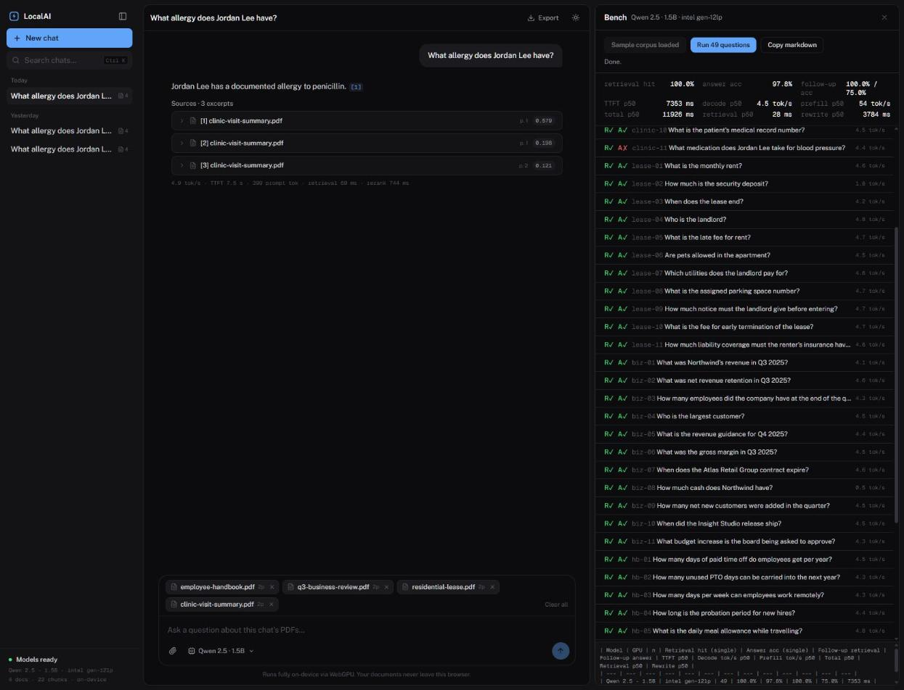
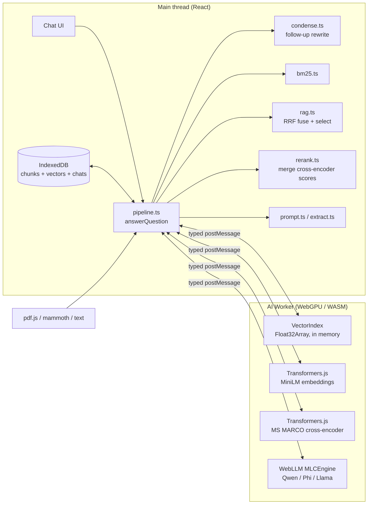

# LocalAI — private document Q&A that never leaves the browser

[](https://github.com/ahm-adsaad/LocalAI/actions/workflows/ci.yml)
[](https://localai.ahmadsaad.dev)
[](./LICENSE)

**Live demo: [localai.ahmadsaad.dev](https://localai.ahmadsaad.dev)** — Chrome or Edge with WebGPU. First load downloads ~1 GB of model weights once; after that it works offline.

Drop in PDFs and ask questions. Retrieval, embeddings, and generation all run on your GPU
inside a Web Worker. There is no backend: no API keys, no document text on the wire,
and no server to trust. Every answer cites the excerpts it came from, and every turn
reports its own latency and throughput.



## What it does

- **Hybrid retrieval plus a cross-encoder, measured.** MiniLM cosine and Okapi BM25 fused with Reciprocal Rank Fusion, then the top 8 re-scored by an MS MARCO MiniLM-L6 cross-encoder, all on-device. On the included golden set the reranker lifts hit@1 from 88.9% to **93.3%** and MRR from 0.933 to **0.959**, and takes verbatim follow-up questions from 75% to **100%** in the top 3. Eight embedders and five rerankers were measured the same way before choosing (tables below).
- **Conversation-aware RAG.** Follow-ups like *"when does her lease end?"* are rewritten into standalone questions on-device before retrieval, and recent questions are carried into the prompt.
- **Grounded answers with page-level citations.** Every chunk knows the pages it was cut from. The prompt labels excerpts `[1] lease.pdf (p. 2)`, the UI turns each `[n]` into a chip whose tooltip names file and page, and the source card shows the page.
- **Schema-driven extraction.** `/extract patient name, allergies, medications` decodes under a JSON-schema grammar (XGrammar via WebLLM), so the model cannot drift into prose, and each field carries the excerpt it came from.
- **Per-turn observability.** Time to first token, decode tokens/s, prefill tokens/s, prompt tokens, retrieval, rerank and rewrite latency, shown under every answer and persisted with the chat.
- **Privacy you can verify, not just read about.** A strict Content-Security-Policy lets the page connect only to itself and the model-weight hosts; ONNX Runtime and fonts are served first-party. A Playwright audit boots the app on a real GPU, indexes a PDF, asks a question, and asserts that no request left for any other host, none carried a body, and none contained document text.
- **Reproducible evals.** A Node retrieval eval runs in CI, `npm run eval:models` compares embedders and rerankers, and an in-browser bench (`?bench`) runs the full pipeline on your GPU and grades answers deterministically.
- **Stop means stop.** The stop button interrupts the engine, so decoding ends at the next step and the partial answer is kept with its stats. (The two short cross-encoder batches that run before generation are not interruptible; on a laptop CPU they are about a second.)
- **Five on-device models** (Qwen 2.5 0.5B/1.5B/3B, Phi-4 mini, Llama 3.2 3B), with a VRAM-aware default and hot swapping in the worker.
- **PDF, text, Markdown and DOCX.** Add `.pdf`, `.txt`, `.md`, `.markdown` or `.docx` files by picker or drop. The parsers (pdf.js, and mammoth for DOCX) are loaded only when a file of that type is added, and extraction happens in the browser.
- **Falls back to a smaller model when the GPU runs out of memory.** If a model does not fit, the app steps down to the next smaller one, says so, and remembers the model that loaded, never the one that failed. Only a simulated out-of-memory has been exercised end to end. It never falls back to a hosted model.

## Architecture



**Ask path:** question → *(rewrite if follow-up)* → embed query → cosine over the in-worker index ⊕ BM25 over chunk text (main thread) → RRF → cross-encoder over the top 8 → prose-aware selection → prompt with page-labelled excerpts and history → streamed, interruptible generation, or grammar-constrained JSON for `/extract`.

The React tree never imports WebLLM or Transformers.js. The worker owns all three models and the dense index, and exposes a typed request/event protocol (`src/lib/types.ts`), so model weights, tensors and vectors never touch the UI thread. The library's vectors cross into the worker once per library change as a single transferred `Float32Array`; a query sends only its text. Embedding runs in length-sorted batches so padding stays small.

## Evaluation

### Retrieval quality (Node, runs in CI)

45 single-turn questions over 4 generated PDFs (clinic visit summary, residential lease, quarterly business review, employee handbook; 22 chunks). Each question names the chunk that must be retrieved. `npm run eval:retrieval` reproduces this table; CI posts it to the job summary on every push.

| Strategy | hit@1 | hit@3 | hit@5 | MRR |
| --- | --- | --- | --- | --- |
| dense (MiniLM cosine) | 82.2% | 93.3% | 100.0% | 0.886 |
| bm25 | 88.9% | 95.6% | 97.8% | 0.927 |
| hybrid (RRF) | 88.9% | 100.0% | 100.0% | 0.933 |
| **reranked** (hybrid top-8 through the cross-encoder) | 93.3% | 100.0% | 100.0% | 0.959 |
| selected (top-3 chunks sent to the prompt) | 93.3% | 100.0% | 100.0% | 0.959 |
| excerpt, head-clipped (the old prompt) | 40.0% | 46.7% | 46.7% | 0.426 |
| excerpt, lexical window | 93.3% | 97.8% | 97.8% | 0.952 |
| **excerpt, lexical window + semantic anchor** (the current prompt) | 93.3% | 100.0% | 100.0% | 0.959 |

The last three rows judge the *clipped excerpt* the model actually reads, not the chunk; the shipped one now matches the chunk row exactly. Follow-up questions asked verbatim with no rewriting (n=4) land the right chunk in the top 3 **75%** of the time after fusion and **100%** after the cross-encoder, which reads "when does *her* lease end?" next to the lease text and does not need the pronoun resolved; the on-device rewrite still runs because it also fixes the question the model is asked.

**The hard case, and what fixing it taught.** *"What medication does Jordan Lee take for blood pressure?"* reaches the prompt (the chunk says "Lisinopril … for hypertension"), but the lexical clip slid to the vitals line, which holds the literal words. Scoring 360-character windows with the cross-encoder did not help: the vitals window still won by 0.1 logits, because every window mixes several sentences. Scoring single sentences did (−3.9 against −7.3 for the runner-up), but anchoring the excerpt on the cross-encoder's sentence broke a different question, *"How much cash does Northwind have?"*, where it preferred the revenue sentence (3.9) over the cash sentence (−1.8) that the lexical window finds trivially. Measured over all 45 questions, every scorer tried, lexical, cross-encoder, MiniLM, or a vote of the two models, lands on 97.8% with one complementary miss, and no fixed blend can satisfy both cases (one needs the semantic bonus above one term weight, the other below half). The shipped rule is simpler: when the lexical window and the semantic anchor disagree, the excerpt carries both, the window plus one capped sentence. Agreement costs nothing; disagreement costs 15 characters on average (281 → 296). Along the way the sentence splitter learned that PDF line breaks are not sentence ends ("A flu vaccine ⏎ was administered…"), which had briefly cost two other questions.

**Two bugs the eval found on its first runs.**

1. *Selection was undoing retrieval.* A hand-tuned prose-density rerank, written against one dashboard PDF, re-sorted the fused list by a display score that mixed cosine with a squashed BM25 value, two numbers on different scales. It pushed fused rank-1 hits out of the top 3 (selected hit@3 93.2% vs 100% fused). It now keeps fused order and only defers number-soup chunks behind prose.
2. *The prompt was throwing the answer away.* Chunks are 700 characters but each excerpt is clipped to 360 to keep WebGPU prefill short, and the clip took the head of the chunk. Retrieval was perfect while the fact reached the model less than half the time. Excerpts now slide to the sentence that matches the question, weighting rare query terms over ones that recur through the chunk, and never cut before the matched term. "What allergy does Jordan Lee have?" went from *"The fact is not there."* to the right answer with a citation.

Both fixes are locked in by unit tests, and the eval row for each is the regression guard.

### Choosing the embedder and the reranker

`npm run eval:models` indexes the corpus with each candidate (every one an ONNX model Transformers.js can run in the browser) and scores the same 45 questions. Full table with hit@k per stage in [eval/results/models.md](./eval/results/models.md); Node CPU timings are relative cost only.

| Embedder (q8) | MB | dense MRR | hybrid MRR | hybrid hit@3 |
| --- | --- | --- | --- | --- |
| **all-MiniLM-L6-v2** (shipped) | 23 | 0.886 | 0.933 | 100.0% |
| snowflake-arctic-embed-xs | 23 | 0.915 | 0.933 | 100.0% |
| mxbai-embed-xsmall-v1 | 24 | 0.900 | 0.944 | 100.0% |
| bge-small-en-v1.5 | 34 | 0.862 | 0.908 | 97.8% |
| gte-small | 34 | 0.874 | 0.930 | 97.8% |
| e5-small-v2 | 34 | 0.899 | 0.919 | 100.0% |
| bge-base-en-v1.5 | 110 | 0.929 | 0.944 | 100.0% |
| nomic-embed-text-v1.5 | 137 | 0.848 | 0.900 | 95.6% |

| Reranker (q8), over MiniLM hybrid, pool 8 | MB | ms/query, Node CPU | hit@1 | MRR |
| --- | --- | --- | --- | --- |
| none | — | — | 88.9% | 0.933 |
| ms-marco-TinyBERT-L-2-v2 | 4 | 72 | 86.7% | 0.926 |
| ms-marco-MiniLM-L-4-v2 | 19 | 278 | 88.9% | 0.937 |
| **ms-marco-MiniLM-L-6-v2** (shipped) | 23 | 262 | 93.3% | 0.959 |
| jina-reranker-v1-tiny-en | 33 | 248 | 91.1% | 0.948 |
| mxbai-rerank-xsmall-v1 | 87 | 801 | 91.1% | 0.950 |

Two conclusions. Once BM25 is in the fusion, the embedder barely matters on this corpus: the best small model moves hybrid MRR by 0.011, the model that moves it most is five times larger, and switching would force every user to re-embed their library, so MiniLM stays. The reranker is a different story: the six-layer MS MARCO cross-encoder is the best choice on *every* embedder it was paired with (including bge-base), and the two-layer one is worse than no reranker at all.

### End-to-end on this machine (browser bench)

Open the app with `?bench`, click **Load sample corpus**, then **Run**. The bench runs every golden question through the exact chat pipeline on your GPU and grades answers by key-fact match. Copy the markdown row it produces.

<!-- BENCH_TABLE_START -->
| Model | GPU | n | Retrieval hit (single) | Answer acc (single) | Follow-up retrieval | Follow-up answer | TTFT p50 | Decode tok/s p50 | Prefill tok/s p50 | Total p50 | Retrieval p50 | Rerank p50 | Focus p50 | Rewrite p50 |
| --- | --- | --- | --- | --- | --- | --- | --- | --- | --- | --- | --- | --- | --- | --- |
| Qwen 2.5 · 1.5B (q4f16) | Intel Iris Xe, integrated (gen-12lp) | 49 | 100.0% | 100.0% | 100.0% | 50.0% | 8631 ms | 4.0 | 46 | 13613 ms | 24 ms | 971 ms | 803 ms | 4556 ms |
<!-- BENCH_TABLE_END -->

Measured 2026-10-21 on the production build in Chrome on a laptop with no discrete GPU, which is the worst realistic case for this app; a mid-range discrete GPU is typically an order of magnitude faster on both prefill and decode. This is the shipped configuration (WASM cross-encoder, sentence focus on). The run overlapped with other CPU load on the laptop, which likely depressed throughput against the previous row (prefill 46 against 54 tok/s, decode 4.0 against 4.5), so read the latency columns as slightly pessimistic. Reading the row:

- **Retrieval is solved for this corpus; the model is the bottleneck.** Every one of the 49 questions had the answering excerpt in the prompt. All 45 single-turn answers are now correct (the previous row had 97.8%), including the hard case above: *"What medication does Jordan Lee take for blood pressure?"* is answered because the excerpt now carries the Lisinopril sentence. Both misses this run are follow-ups, with retrieval correct for each. *"When does their contract expire?"* was answered correctly last run, so the cause is unclear. Sampling noise at temperature 0.4 on a 1.5B model is one candidate (follow-up answers went from 75.0% to 50.0% on n=4, which is one question flipping, not a trend), but the previous row predates the sentence-focus pass, so the new excerpt is an equally plausible cause. *"and for tuition?"* is the same miss as before: the rewrite stays anchored on the previous topic.
- **The follow-up rewrite works, and the reranker covers for it.** Verbatim follow-ups retrieve the right chunk 75% of the time with fusion alone and 100% with the cross-encoder; rewritten ones, 100% either way. The rewrite costs one short extra generation (4.6 s here, a few hundred ms on a discrete GPU) and only runs when the question looks context-dependent.
- **Reranking is the one retrieval stage you can feel, and it stays on WASM.** Hybrid search over the whole library takes 24 ms; the cross-encoder's eight pairs take 971 ms on this laptop's CPU (WASM), and the sentence-focus pass, about 28 short pairs in a second batch, takes another 803 ms. The cross-encoder was also measured on WebGPU on the same machine: once warm the 8-pair rerank is about 3.7x faster (roughly 200 ms against 750 ms), but the focus batch is not (about 800 ms against 440 to 760 ms), so the whole stage nets only 15 to 25% depending on how you average. The first question also pays about 4.9 s, mostly one-off shader compilation. That did not justify putting the encoder next to the LLM in VRAM, so WASM ships; the table and the two changes that might flip the result are in [NOTES.md](./NOTES.md#vector-search).

## Privacy, enforced

"Your documents never leave the browser" is a claim most local-first apps make and none can show. Here it is checked three ways.

1. **Content-Security-Policy.** The page may connect only to its own origin and the model-weight hosts (`huggingface.co`, `*.hf.co`, `raw.githubusercontent.com`); scripts are first-party only, with `'wasm-unsafe-eval'` so WebLLM and ONNX Runtime can compile the WebAssembly they download. ONNX Runtime's runtime files and the fonts are bundled and served from this origin instead of a CDN. The same policy string is sent by the production host (`public/_headers`) and by `vite preview`, and a unit test keeps them identical, so a dependency that tried to phone home would be refused by the browser, not by a promise.
2. **A Playwright audit** (`npm run test:e2e`). It boots the production build in Chrome on the real GPU, indexes a sample PDF, asks a question, and then checks every request the browser made during the session: none went to a host outside the allowlist, none carried a body, none contained text from the document, and the CSP never had to block anything. It runs locally (WebGPU); CI runs the header and boot checks from the same suite on every push.
3. **No remote fallback.** If on-device generation fails, the UI shows the error.

## Design decisions

| Decision | Why |
| --- | --- |
| One worker owns all models and the index | Embedding, reranking, generation and dense search share a single message surface; nothing blocks React paints during multi-second loads. |
| Embeddings and reranker on WASM, LLM on WebGPU | The Q4 LLM owns most of the VRAM budget; keeping the small encoders on WASM avoids contention. |
| Cross-encoder stays on WASM (measured) | WebGPU is about 3.7x faster on the 8-pair rerank after warm-up but slower on the many-short-pairs focus batch, nets roughly 15 to 25% over the stage, adds a ~4.9 s first-question cost, and a failure inside its session create cannot fall back to WASM. The switch is one constant (`RERANKER_DEVICE`). |
| Step down a model on GPU memory failure | A 3B model that does not fit should not strand the user on an error. The chain is Qwen 3B / Phi-4 mini / Llama 3B, then Qwen 1.5B, then Qwen 0.5B, then the error, and a fallback must need at most 75% of the failed model's VRAM estimate. The notice names both models, and the failed model is never saved as the preference. |
| RRF over score blending | Cosine and BM25 scores live on different scales. Rank fusion needs no calibration and the eval confirms it beats either alone. |
| Rerank only the top 8 | A cross-encoder reads question and chunk together, so it catches paraphrases bi-encoders miss, but it costs a forward pass per pair. Fusion already has 100% hit@5, so eight candidates cover every answer at a fixed, small cost. |
| Keep MiniLM | Measured, not assumed: no small embedder beats it by more than 0.011 MRR once fused with BM25, and changing embedders invalidates every stored vector. |
| Two excerpt signals, both kept on disagreement | The lexical window and the cross-encoder's best sentence fail on different questions and no blend fixes both. When they disagree the excerpt carries both; when they agree it costs nothing. |
| Vectors stay in the worker | Sending every vector with every query serialised the whole library per question. The worker now holds one `Float32Array` and the query message is a string. |
| CSP over promises | A privacy claim the browser enforces is worth more than one in a README. |
| Rewrite follow-ups only when needed | The rewrite is an extra on-device generation. A cheap heuristic (pronouns, "what about", short questions) gates it so self-contained questions pay nothing. |
| Grammar-constrained extraction | A JSON schema compiled to a decoding grammar beats "please answer in JSON" on a 1.5B model: the output always parses and never carries prose. |
| Short prompts, small top-k | Prefill dominates WebGPU latency. Excerpts are clipped to 360 chars and k stays at 3–5 so answers start in about a second on a laptop GPU. |
| No remote fallback, ever | If on-device generation fails, the UI shows the error. A silent fallback to a hosted model would break the only promise the app makes. |

More in [NOTES.md](./NOTES.md).

## Stack

| Piece | Choice |
| --- | --- |
| UI | Vite + React 19 + TypeScript + Tailwind 4 |
| LLM | `@mlc-ai/web-llm` (MLC, WebGPU) — Qwen 2.5 / Phi-4 mini / Llama 3.2, q4f16 |
| Embeddings | `@huggingface/transformers` — `Xenova/all-MiniLM-L6-v2`, q8, WASM |
| Reranker | `@huggingface/transformers` — `Xenova/ms-marco-MiniLM-L-6-v2` cross-encoder, q8, WASM |
| Retrieval | Cosine (in-worker `Float32Array` index) + Okapi BM25 + RRF + cross-encoder, in `src/lib/` |
| Inputs | `pdfjs-dist` (lazy) with glyph-position reading-order reconstruction and page-tagged chunks; `mammoth` (lazy) for DOCX; text and Markdown read directly |
| Persistence | IndexedDB via `idb` |
| Tests / eval | Vitest, Playwright, Node eval harnesses, in-browser bench |
| Hosting | Cloudflare Workers static assets with COOP/COEP and CSP headers |

## Run it

```bash
npm install
npm run dev          # http://localhost:5173
npm test             # unit tests (retrieval, reranking, chunking, prompts, extraction, CSP)
npm run test:e2e     # production build in Chrome: CSP headers, the GPU privacy audit, and (locally) the model fallback and PDF/text/Markdown/DOCX input specs
npm run fixtures:docx  # regenerate the DOCX fixture used by the input spec
npm run typecheck
npm run lint
npm run eval:pdfs    # render eval/corpus/*.txt → public/samples/*.pdf
npm run eval:retrieval
npm run eval:models  # compare embedders and rerankers (downloads ~0.5 GB once)
```

Requires Chrome 113+ or Edge 113+ with hardware GPU acceleration. Try the sample PDFs in `public/samples/`, then ask *"What allergy does Jordan Lee have?"*, follow up with *"what medication does he take for blood pressure?"*, or run `/extract patient name, allergies, next appointment`.

## Project layout

```
src/lib/pipeline.ts      the whole ask path, React-free (shared by chat and bench)
src/lib/ingest.ts        file → chunks → embeddings → IndexedDB
src/lib/inputs.ts        accepted file types and how each is classified
src/lib/documents.ts     text extraction per type (pdf.js and mammoth loaded lazily)
src/lib/gpuErrors.ts     recognises GPU out-of-memory failures for the model fallback
src/lib/focus.ts         sentence-level excerpt focus with the cross-encoder
src/lib/rag.ts           RRF fusion, overview detection, source selection
src/lib/rerank.ts        cross-encoder pool + merge (shared by app and eval)
src/lib/bm25.ts          Okapi BM25 over chunk text
src/lib/vectorIndex.ts   in-worker Float32Array dense index
src/lib/batching.ts      length-sorted embedding batches
src/lib/chunking.ts      paragraph-aware chunks tagged with their PDF pages
src/lib/condense.ts      follow-up → standalone question rewrite
src/lib/prompt.ts        query-focused excerpts, grounded prompt, citation markers
src/lib/extract.ts       /extract command, JSON schema, result parsing
src/lib/citations.ts     [n] markers → links to source cards, page labels
src/lib/csp.ts           the Content-Security-Policy (mirrored in public/_headers)
src/lib/stats.ts         per-turn TTFT / tok/s accounting
src/lib/metrics.ts       hit@k, MRR (shared by Node eval and browser bench)
src/lib/grading.ts       deterministic answer grading for the bench
src/worker/ai.worker.ts  WebLLM + Transformers.js + VectorIndex behind a typed protocol
src/components/BenchPanel.tsx  ?bench panel: load corpus, run, copy markdown
eval/                    corpus, golden set, PDF renderer, retrieval eval, model comparison, results
e2e/                     Playwright: CSP/header checks (CI); privacy audit, model fallback and input specs (local, real GPU); fixtures/
```

## License

MIT © Ahmad Saad
